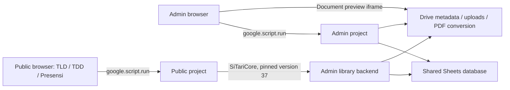

# SITARI DISKUM v3 — remaining performance bottleneck audit

Date: 7 November 2026 (Asia/Jakarta). Baseline: `356c97cdca6b67358edb042463de05ea7258bc7f`, branch `main`.

## 1. Executive assessment and scope

There is evidence of avoidable work in startup, calendar construction, attendance-tab reads, document downloads, and frontend rendering. There is **not yet an instrumented production latency baseline** that identifies the dominant cause of the reported delay. Google Sheets, Apps Script startup/queuing, library boundaries, browser work, asset downloads, and Drive preview/conversion must therefore remain separate hypotheses.

The strongest next step is a measured GAS optimization pass, not a database migration. Existing optimizations should be preserved: a simple Konfirmasi lookup already retrieves only the selected visitor and workflow rows. Making that lookup targeted again would repeat completed work.

This audit changed no application source, business rules, UI, authentication, deployment settings, Sheets, or Drive data. It ran local tests and synthetic read-only service mocks. A versioned Apps Script source download used the content API; it did not execute production functions. Only this report is intended for the audit commit.

Review order followed the requested README, repository-baseline note, two October performance plans, and `performance.test.js`, then current source. Private local configuration was available for inspection; no staff identifiers, contact values, credentials, operational file IDs, or private document contents are reproduced here. See [repository baseline exclusions](../REPOSITORY_BASELINE.md) before reproducing tests on a fresh clone.

### Evidence labels

- **Confirmed code/work count:** demonstrated directly in current code or a synthetic invocation of that code. This establishes work performed, not user-visible milliseconds.
- **Previously resolved:** implemented behavior protected by existing tests.
- **Needs measurement:** plausible latency contributor with no current production timing attribution.
- **External-service dependent:** cost lies partly in Google/Fonnte/browser networking and cannot be inferred from a local mock.

No improvement percentage, production p95, or promise of instantaneous workflows is claimed.

## 2. Current architecture

### Projects and version boundaries

| Component | Current role | Performance implications |
|---|---|---|
| `Admin/` | Admin HTML service, privileged workflows, shared backend/library | Admin browser RPCs call this project directly; opening EDIT does not inherently traverse Public. Local deployment registry records Admin version 45. |
| `Public/` | Generated public TLD, TDD, and Presensi HTML service | Its manifest pins `SiTariCore` to immutable Admin library **37**, development mode off. Registry records Public version 15. Public is not automatically updated when Admin changes. |
| `Tamu-Luar/` | TLD authoring HTML, directory/validation and intake source | Used by the public build; no additional active standalone hop should be inferred from this directory. |
| `Tamu-FO/` | TDD authoring HTML, directory/validation and intake source | Its registration implementation is incorporated into the shared intake module. Historical standalone entry points are not the active Public route. |
| `maintenance/build-public.js` | Generates Public files and private `Admin/PublicIntake.js` | Requires a deliberate library-version selection. Do not run it against production files merely to benchmark. |
| `local-test/` | Node HTTP preview, synthetic state/storage, VM tests | Useful for contracts and frontend work. It does not emulate Google transport, cold starts, Google service latency, or the real DOM rendering pipeline. |



The public wrappers are bounded registration/attendance functions, not arbitrary Admin RPC forwarding. Preserve this boundary in any consolidation. Shared backend ownership of database access and write coordination must also be preserved.

The published library-37 source was downloaded read-only into an ignored local audit directory. Twelve relevant functions match local source exactly: `getDashboardData`, `getTamuList`, `getRapatCalendar`, `getMasterData`, `savePresensiRapat_`, `getVisitWorkflow`, `readVisitWorkflow_`, `getVisitAttendanceRoster`, `saveVisitWorkflow`, `getPublicAttendanceMasterData`, `getPublicAttendanceCalendar`, and `getAgendaPhotosMap_`. Thus the read-path findings below apply to the inspected Public library as well as local Admin code. This comparison is not a live response-time test or a claim that every file in versions 37 and 45 is identical.

`GLOSSARY.md` and the older ADR describing three separately deployed projects are useful historical context, but differ from the current two-project build and several current workflow rules. The source, manifest, and current README take precedence for this audit; those historical documents were not rewritten.

### Startup and request sequences

1. **Admin HTTP entry:** `Admin/Code.js::doGet` calls deployment configuration, document-sharing migration, room migration, and employee import guards before evaluating the template. Completed guards usually return after Script Properties checks. If a guard is not complete, initialization can copy a spreadsheet, enumerate Drive files, or write data/settings. This is a conditional initialization path, not evidence of a repeated Drive scan on every normal load. Production page loads were deliberately not used as audit probes.
2. **Browser boot:** `Admin/Index.html::initializeApp` sets QR URLs and room cards, then calls `loadAllDashboard`. That function issues three **parallel** RPCs: `getDashboardData`, `getTamuList`, and `getRapatCalendar`. Do not propose parallelizing these calls again.
3. **Rendering:** each result renders its own panels; guests also populate monthly reporting, and calendar data renders the calendar/month grid and meeting list. These operations are not generally restricted to the active visible tab. The 30-second meeting timer and window-focus handler rerender local agenda data; they are **not periodic backend polling**.
4. **Header refresh:** `refreshHeaderData` reuses the three-call loader, disables its button while requests settle, and reports partial failure. It does not reload the document. It prevents repeated clicks on that button, not all duplicate endpoint calls from other application actions.
5. **Public routes:** `Public/Code.js::doGet` renders TLD without a directory RPC, obtains TDD destinations through the library, and obtains the employee count for Presensi through the library. `Public/Presensi.html::loadInitialData` then requests calendar and master data separately. An agenda-specific QR still initially fetches the full calendar and master lists; a TLD selection can add a roster request. URL selection has both browser-query and `google.script.url.getLocation` paths; duplicate roster requests should be measured, not assumed for every load.
6. **Intake:** public registration delegates to the shared intake module. TLD document conversion/creation, ID selection, appends, and table sorts occur on the registration path. The old standalone source's database-discovery helper is replaced by `getSpreadsheet` in the generated backend; do not count it as an extra active database-discovery hop.

### Storage, writes, documents, and caches

| Path | Functions and behavior |
|---|---|
| Dashboard | `Code.js::getDashboardData` scans visits, meetings, SPPD, and employee master; `getTamuList` separately reads/maps all visits. |
| Calendar | `Code.js::getRapatCalendar` reads meetings, E-notula metadata, photo metadata, and attendance; it maps and joins them in JavaScript. `readMeetingRows_` reads both raw and display values. |
| Visit detail | `VisitWorkflowStorage.js::getVisitWorkflow/readVisitWorkflow_`, `Code.js::findRecordByColumn_/getVisitByCode_`; exact ID lookup with TextFinder and selected-row reads. Lazy tab 2 adds rooms; 3/4 add attendance; 5 adds archive metadata. |
| Visit save | `saveVisitWorkflow` holds a script lock, checks authorization and workflow version, reads fresh data, applies rules, writes workflow/visitor/evidence, flushes, and rereads a full response. Booking uses fresh room/conflict validation. |
| Attendance | `getVisitAttendanceRoster`, `submitManualVisitAttendance`, `savePresensiRapat_`, `getAgendaAttendance`; several paths load full calendar/attendance/workflow tables to select one agenda. Bulk manual entry invokes the per-person save path repeatedly under the outer lock. |
| Documents | `VisitArchive.js::getVisitArchiveDocument` reconstructs visit context and archive membership before each Drive read. `AgendaDocuments.js` handles E-notula/photo metadata and photo content. No Drive blob is fetched merely by returning a workflow's stored file URL. |
| Upload / completion | `saveVisitWorkflowFile_`, intake `saveBase64ToDrive_`, and `generateVisitAttendancePdf_` decode base64, create Drive files, set document sharing, or convert HTML to PDF. These are write/action costs, distinct from ordinary detail reads. |
| Stable master cache | `Code.js::cachedMasterRead_` caches all-master or room responses for 120 seconds, using database-specific/versioned keys. Cache errors fall back to direct reads; master migrations invalidate the cache. |
| Browser reuse | Current visitor list supplies the immediate read-only detail snapshot; same-version loaded tabs are reused within the modal; room options use session result/in-flight reuse. Kedatangan intentionally refreshes attendance. |
| Mutable data | No general cross-project persistent cache of visitor lists or approval state is present. Save/version checks stay fresh; request tokens suppress stale rendering rather than cancelling server execution. |

## 3. Existing optimizations and their protections

| Already implemented | Evidence / regression protection |
|---|---|
| Immediate EDIT/manual shell, read-only cached visitor snapshot, closable failures | `VisitModal.html`, `VisitAttendance.html`; `performance.test.js` checks pre-response display, cached escaping, error behavior, and close/new-selection races. |
| Exact visitor/workflow lookup | `findRecordByColumn_` and `getVisitByCode_`; `lazy-workflow.test.js` verifies complete-ID matching, row reordering compatibility, and selected-row reads. |
| Lazy workflow tabs | `getVisitWorkflow({tab})` and `selectVisitTab`; tests cover current tab, unloaded tabs, same-version merge, changed-version discard, unavailable tabs, and late responses. |
| Fresh attendance and restricted roster behavior | Existing performance/lazy tests cover re-entering Kedatangan and attendance joined by agenda ID despite later recording dates. Other attendance tests cover QR/manual locks and dates. |
| Reduced ordinary workflow reads | A booked full workflow read shares one spreadsheet handle and avoids employee/OPD master reads; `performance.test.js` asserts the expected open/read counts. This does not mean every nested action/download reuses that handle. |
| Stable master cache and room request reuse | `lazy-workflow.test.js` checks cache hits, configured TTL, fallback, and booking bypass; `performance.test.js` checks in-flight sharing and retry. Cache expiry tests use a mock cache and do not benchmark live CacheService behavior. |
| Targeted post-save updates | `applyVisitUpdate` updates local lists/reports, protects newer saved rows against old fetches, and requests summary/calendar only for selected actions. Protected by `performance.test.js`. |
| Concurrent archive retrieval | `ArchiveClient.html::mergeVisitArchivePdf_` uses at most two source downloads concurrently, preserves manifest order, and fails explicitly. `archive-pdf.test.js` protects this behavior. Do not recommend making an already-concurrent path concurrent again. |
| Header refresh completion handling | `header-refresh.test.js` checks three-request completion, repeated-click suppression, partial failure, and button release. |

On this audit run, **30 selected tests passed, zero failed**:

```powershell
node --test local-test/test/performance.test.js local-test/test/lazy-workflow.test.js local-test/test/header-refresh.test.js local-test/test/archive-pdf.test.js
```

The historical plans' 113/126-test counts describe earlier work. They are not current latency benchmarks. No production timing improvement is inferred from passing tests.

## 4. Remaining bottlenecks, ranked by potential user impact

Ranks are hypotheses about contribution to perceived delay, not measured production attribution. If transport dominates a small dataset, service/asset startup can outrank row processing; if tables grow, scanning and rendering can dominate.

| Rank | Finding and evidence class | Relevant source and why it matters | Measurement that would confirm impact |
|---|---|---|---|
| 1 | Broad, overlapping startup reads and unbounded list responses — **confirmed work**, latency share unmeasured | `Index.html::loadAllDashboard`; `Code.js::getDashboardData/getTamuList/getRapatCalendar`. Three independent opens; visits and meetings are read in more than one endpoint. Dashboard computes/returns `loStats`, which current Index code does not consume. Full visit objects include contact/member/document fields needed by detail workflows rather than all list views. | Per-endpoint server spans, table/cell counts, JSON sizes, and visible-dashboard readiness under actual data distribution. |
| 2 | Apps Script request/initialization overhead and Public library boundary — **external/needs measurement** | Every RPC has transport/execution overhead. Public additionally delegates through library 37. Admin EDIT is direct, so a Public-library explanation cannot explain all Admin modal delay. `Index.html` also loads runtime Tailwind and deferred PDF libraries before its DOM-loaded initialization; fonts/icon styles add external resources. | Browser resource waterfall, request round-trip vs server duration, and direct/wrapper/core spans, separately for first observed and repeated requests. |
| 3 | Remaining full-table detail/attendance/archive reads — **confirmed work** | Lazy Kedatangan/SPPD still reads all attendance rows to return one agenda's entries. `refreshVisitAttendance` omits `tab`, taking the full-detail path. `getAgendaAttendance` reads all agenda IDs/titles and attendance rows. Each archive-source download rereads attendance/rooms despite needing document membership, then opens Drive. | Selected-row vs total-row counters; split lookup/read/filter/Drive spans; aggregate work per complete archive and per manual batch. |
| 4 | Eager/repeated frontend work and growing DOM — **confirmed work**, browser impact unmeasured | `renderTamuTable/renderMeetingsList/renderMonthlyReport` generate full results, including hidden panels; search runs on every input event without debounce. `filterAgendaRecords_` constructs/serializes each row's searchable content even for an empty query. `setBookingCalendarState` builds a month even when the popup is closed, with per-day scans/sorts. Timer/focus reconstruct the full meeting list. TLD cards can repeatedly search `allTamuData` through `canAdminRecordAttendance`. | Long Tasks and browser performance traces, visible vs hidden render spans, generated row/node counts, typing-to-next-paint and click-to-next-paint. |
| 5 | Repeated calendar document scans — **confirmed algorithmic inefficiency** | `getRapatCalendar` uses `docs.some` and up to two `docs.find` calls per meeting; with matching records this is an O(meetings × document rows) join. Photos already use an ID map, and manual attendance already uses a Set; those resolved patterns should not be reworked blindly. | Comparison count and transform-only elapsed time at realistic table sizes, separately from Sheets time. |
| 6 | Repeated/full save context and synchronous external work inside write locks — **confirmed path, external duration unmeasured** | `saveVisitWorkflow`, `bookVisitAgenda_`, `syncVisitSppdEvidence_`, `submitManualVisitAttendance`, intake registration. Full before/after reads; SPPD synchronization still scans a table; nested calendar reads; per-person attendance read/sort; notification fetches and PDF/file operations can hold the write lock. | Lock-wait/hold duration, individual read/write/sort/flush/Drive/Fonnte spans, and total work per user action. |
| 7 | Workflow document previews and archive memory — **external/needs measurement** | `visitDocumentPreview` emits lazy Drive preview iframes; tab render rebuilds panel HTML and can recreate frames. Preview latency is independent of receiving authoritative workflow JSON. Archive concurrency is bounded, but downloaded base64 files accumulate before merging; two in-flight requests do not cap total archive memory. | Text-ready vs frame-load events, resource timing, supported-size archive memory/CPU on a real phone, and per-file Drive/conversion timing. |
| 8 | Global in-flight deduplication/version-aware reuse gaps — **confirmed potential requests**, frequency unmeasured | Room and header-button requests are guarded, but `loadAllDashboard` has no general same-endpoint coalescing. `openVisitWorkflow` can issue another request while an earlier load is pending; tokens protect correctness but do not abort work already dispatched. Creating a meeting still calls the broad three-request loader. | Request counts for rapid same-record clicks, switching records, header refresh overlapping a save, and successful meeting creation. |

Small header-clock formatting costs, dormant legacy code, and generic minification are not ranked ahead of these paths without a browser trace. Removing them now would be speculative cleanup.

## 5. Read-only local probe results

The ignored local probe `outputs/performance-audit/probe.cjs` evaluates actual backend and frontend functions in Node VM contexts. Google services are replaced by in-memory read-only mocks; no production function is invoked. Synthetic records contain no real people or file IDs. The source and result artifacts remain local and are not part of this report-only commit.

Fixtures: N visitors, N agendas, 5N attendance records, N E-notula records, N photo-metadata records, 70 synthetic master employees, and populated workflow rows. All fixture agendas share a date; byte sizes are consequently workload examples, **not production payload measurements**. Runtime: Node `v24.22.0`.

### Startup service work

| Endpoint | Spreadsheet opens | Range value/display reads | Tables |
|---|---:|---:|---|
| `getDashboardData` | 1 | 5 | Visits; meetings raw and display; SPPD; employee master |
| `getTamuList` | 1 | 1 | Visits |
| `getRapatCalendar` | 1 | 5 | Meetings raw and display; E-notula; photos; attendance |
| Combined three requests | **3** | **11** | Repeated visits/meetings plus supporting tables |

These counts exclude metadata calls such as `getLastRow/getLastColumn`, TextFinder calls, and HTML-entry work. They count API method invocations in the mock, not guaranteed distinct network round trips inside Google's implementation.

| N | Combined JSON bytes | Calendar document-ID comparisons | Attendance rows fetched for tab 3 | Selected attendance rows returned |
|---:|---:|---:|---:|---:|
| 20 | 32,415 | 630 | 100 | 5 |
| 200 | 247,524 | 60,300 | 1,000 | 5 |
| 1,000 | 1,206,733 | 1,501,500 | 5,000 | 5 |

For the same inputs, a Konfirmasi tab-0 read performs **one spreadsheet open, two selected-row reads returning two rows in total, and two TextFinder calls** at every tested N. This validates the earlier targeted-lookup optimization. It does not establish that server-side TextFinder latency stays constant as Sheets grow.

One completed-visit document download performs **two spreadsheet opens, five range-value reads, a full attendance read, and one Drive file lookup** in the synthetic path. The second open comes from document metadata retrieval without passing the existing spreadsheet handle. A multi-file archive repeats this context-building work per file; existing two-worker concurrency reduces serialization of downloads but does not remove the repeated reads.

### Frontend work, not browser paint time

| Input rows | Guest rows generated | Guest HTML bytes | Internal-agenda HTML bytes |
|---:|---:|---:|---:|
| 20 | 20 | 31,250 | 44,452 |
| 200 | 200 | 313,070 | 445,074 |
| 1,000 | 1,000 | 1,566,670 | 2,226,676 |

The uncompressed locally rendered Admin document is 227,913 bytes before loading external CSS/fonts/PDF libraries and data. A no-query search probe over 1,000 rows with one nested object per row still serializes **1,000 nested objects**. The agenda HTML fixture uses internal meetings; it does not exercise worst-case TLD-to-visitor lookup work.

These probes use stub DOM elements: they measure generated work/size, **not DOM insertion, style calculation, layout, painting, device responsiveness, Google network latency, or measured speed gains**. They support prioritizing a real browser trace rather than declaring a final root cause.

Replication recipe: restore private test/config files, run the test command above, then wrap `SpreadsheetApp.openById`, range `getValues/getDisplayValues`, TextFinder, and document-array callbacks with counters in a VM-only harness. Supply the stated table shapes at N=20/200/1000; execute the three startup endpoints and `getVisitWorkflow` tabs 0/3. Separately invoke the unmodified render functions with stub elements and count output rows/bytes. Do not point this harness at production services.

## 6. Proposed measurements and safety limits

Instrumentation below is a **proposal for a later approved step**, not code deployed by this audit. First obtain browser-only traces and existing execution-log information. Any server spans should be trialed in a disposable test environment or separately approved for production; do not silently add timing endpoints, sheet columns, or a metrics database.

Even a nominal read endpoint can reach `getSpreadsheet`, whose missing/invalid-configuration fallback can discover or create a database and initialize sheets/folders. Verify configuration and completed initialization separately before any later live timing run. This audit used service mocks and the source-content API, not production HTML/RPC execution.

| User-visible or server interval | Measurement design | Important limits |
|---|---|---|
| Initial dashboard readiness | Browser marks: navigation, shell painted, startup RPC dispatch/response, summary DOM inserted, first following animation frames. Track dashboard-ready separately from all hidden data-ready. | DOMContentLoaded, an HTTP 200, and completion of all three requests are different milestones. A pair of animation frames is a paint opportunity, not proof the human saw it. |
| Apps Script handler duration | Correlate browser request with handler entry/exit; add nested elapsed spans around authorization, database open, reads, transforms, response assembly. | Use durations within each clock domain. Do not subtract unrelated browser/server absolute timestamps. Cold/runtime setup and queue time may occur before handler entry. |
| Sheets cost | Wrap metadata calls, TextFinder, `getValues/getDisplayValues`, writes, sort and flush individually. Record table category, row/cell counts, cache hit/miss, elapsed time. | Report service wait separately from JS filtering. Read-only audit runs must never execute write wrappers against production. |
| Transform/serialization cost | Time mapping/filtering, doc joins, roster matching, and explicit test `JSON.stringify` separately using already-read synthetic arrays. | Framework response serialization is not necessarily identical to a standalone JSON.stringify measurement. Avoid mixing service time into this span. |
| Drive cost | Separate metadata/file lookup, blob transfer, native-document/image conversion, file creation, sharing operations, and HTML-to-PDF generation. | Write/conversion experiments belong in the test environment. Do not alter production permissions or replace existing file references. |
| RPC overhead | Browser round-trip duration minus measured handler duration, accompanied by response bytes and request counts. | Label residual as unallocated transport/queue/runtime/serialization/callback overhead, not pure network time. |
| Public library overhead | Public wrapper entry/exit plus nested shared-core entry/exit for the same bounded read. Compare repeated calls with matching fixture/cache conditions. | Distinguish wrapper/library work from Sheets work and browser transport. Do not bypass access boundaries or upgrade the pinned library merely to make a comparison. |
| Visit-detail readiness | Click → read-only snapshot paint; dispatch → authoritative data callback; callback → active-tab content paint; controls enabled; separate preview-frame load. | Keep fresh server authorization/version checks before enabling actions. Cached text being visible is not a completed authoritative load. |
| Workflow-tab readiness | Tab click → cache hit or RPC; selected tab response → text/table ready; separate PDF/preview events. | Same-version cached tabs and mandatory fresh Kedatangan reads must be separate cohorts. Cross-origin iframe load does not prove the PDF has visually finished rendering. |
| Frontend responsiveness | DevTools performance/Long Tasks trace, DOM/node counts, filter typing-to-next-paint, hidden/visible rerender spans, asset waterfall and main-thread parse/execute time. | Test real browser layout on representative phones as well as desktop. Local VM and a width-only viewer do not emulate phone CPU/network. |

Use scenario IDs and aggregated counts rather than names, employee identifiers, phone numbers, visit codes, document URLs, tokens, or content. Keep HAR files/private traces out of Git; redact headers/query strings before sharing. Do not log authorization tokens or Fonnte payloads.

Suggested experiment matrix:

1. Small, representative, and growth-size synthetic datasets; visits, agendas, attendance, documents, and history size varied independently.
2. First observed request and repeated requests, plus master-cache hit/miss cases; do not clear production caches or migrations to manufacture a cold case.
3. Dashboard first load/header refresh; first/repeated record open; current stages 0/2/3/4/5; same-version vs changed-version tab loads; rapid same/different record clicks.
4. Direct Admin versus Public attendance; fixed-QR versus chooser; zero/one/many documents; successful and failed preview loads.
5. Test-environment write scenarios: notification/evidence/book/finish, room-conflict race, one vs many manual attendees, photo+finish two-save path, small/large archives. No real WhatsApp sends.

Collect repeated samples sufficient to report distributions (for example 30 per scenario with first-observed requests identified separately), p50/p95, errors, payload size, and request/read counts. Alternate before/after runs under equivalent conditions; compare both user-visible milestones and backend spans. Agree acceptance budgets after seeing the baseline; no arbitrary latency reduction is promised here.

## 7. Prioritized optimization roadmap

All items are proposals. Preserve approved visual styling/layout, active tabs, search/sort/report behavior, authentication, server authority, workflow version checks, attendance dates/locks, file ordering and existing Drive URLs.

| Priority | Proposed change | Expected measurable benefit | Effort / regression risk / reversibility |
|---|---|---|---|
| P0 | Establish the span/request/byte baseline above | Identifies whether the dominant delay is transport, initialization, reads, transforms, rendering, or preview/Drive. | Low–medium; low risk when browser-only/isolated; remove observers/probes to revert. |
| P1 | Consolidate the initial data snapshot or reuse one request-scoped read model, and narrow dashboard/list projections | Fewer duplicate visits/meeting reads and less unused data; remove unused `loStats` computation from the dashboard contract only after checking all consumers. | Medium; medium risk from partial failures/order/consumer contracts. Keep existing endpoints and feature-gate the new boot path for rollback. Do not replace parallel calls with a slower sequential chain. |
| P1 | Index calendar joins once per request; short-circuit empty search; avoid building hidden panels/month grids until needed | Fewer document-ID comparisons, unnecessary serialization and initial DOM work, with the same visible output. | Low–medium; low–medium risk. Preserve first-match behavior for duplicate document rows, error behavior, and render-on-first-open/time-sensitive status updates. Revert individual internal helpers if needed. |
| P1 | Narrow selected-agenda attendance and archive read context; pass existing spreadsheet handles through nested reads | Fewer unrelated rows/cells and context reads for slow workflow tabs and each archive source. | Medium; medium risk. Preserve exact ID/member matching and per-document authorization. TextFinder/targeted row ranges reduce transferred cells but are not assumed to provide a database index or constant-time cloud lookup. |
| P2 | Coalesce identical in-flight requests; reuse authoritative response state; replace the remaining broad refresh after meeting creation with an appropriately scoped refresh | Fewer redundant RPCs during repeated clicks, refresh/save overlap and post-save navigation. | Medium; medium risk. Use revision-aware invalidation; never replay stale authorization/approval state or turn failure into an indefinitely cached empty result. |
| P2 | Profile then defer nonessential PDF libraries/static asset work; consider a build-time equivalent of runtime Tailwind | Earlier visible readiness if assets/parse time are on the critical path. | Medium; medium risk to exact styling, mobile behavior, SRI/CSP compatibility and first-use export. Keep dependency versions and an explicit loading/failure path; rollback asset changes independently. |
| P2/P3 | Debounce expensive text filtering and use reusable read models/maps; evaluate progressive data loading or internal chunking | Lower typing/render cost and payload size at growth volumes. | Medium–high; medium–high risk. Preserve comma-OR search across the full dataset, exact-date filters, sort order, dashboard counts, monthly report/export completeness and list-to-detail navigation. |
| P3 | Batch work inside existing validated write transactions, especially multi-person attendance and repeated post-save reads | Lower lock hold time and per-person repeated scanning/sorting. | Medium–high; high risk. Preserve concurrency, idempotency, partial-failure semantics, uniqueness and authoritative conflict/version checks. Change only after write spans identify the cost. |

### Caching and pagination constraints

- Keep the existing stable-master cache and fresh booking-validation bypass. Browser room-option results currently persist for the page session; measure whether an explicit refresh/invalidation policy is needed, without treating cached room data as booking authority.
- Prefer request-scoped indexes and same-version browser reuse before introducing another persistent cache. Any future summary cache requires a clear freshness contract and invalidation on intake, booking, reschedule, finish, and attendance changes as applicable. Never cross-cache per-user privileged workflow data in the Public project.
- Smaller startup summaries can help before paging. Current `allTamuData` drives search, detail snapshots and full monthly reports; truncating it silently breaks these consumers.
- Visible pagination controls would change the approved UI and require separate approval. Transport pagination, progressive loading or virtualization must preserve complete search/report behavior and keyboard/focus/expanded-card state; virtualization is not a risk-free drop-in.
- Do not simply remove locks or move network/file operations outside them. External side effects and retries require an idempotency/transaction design. An asynchronous notification/document queue would be a separate, reviewed change, not a silent performance tweak.

## 8. Regression tests required before any optimization

Retain the existing tests and add tests that exercise actual call-site behavior, not merely implementation-shaped assertions:

1. **Startup/API contracts:** counters/recent/today/calendar equivalence, empty/large datasets, optional fields, partial failures, overlapping requests, and post-save revision races. Assert bounded read/request work with service mocks; assert timing only in a suitable controlled performance harness.
2. **Calendar/indexing:** correct status/photo/manual-lock/E-notula results for missing, duplicate, malformed and string-vs-number IDs; identical meeting conflict checks and 24-hour/WIB formatting.
3. **Detail/tabs:** immediate read-only snapshot, fresh authorization before reads, unavailable tabs rejected, same-version merging, changed-version discard, close/new-selection races, mandatory fresh attendance, and eligibility of late admin attendance.
4. **Read projections/pagination:** full-data comma-OR/date search, all sort keys/status ordering, monthly PDF/image completeness, recent-list detail navigation, filtering beyond the first returned chunk, and preservation of original Drive references.
5. **Writes/locking:** concurrent room conflict and workflow version races; duplicate member submissions; QR vs bulk Admin vs AdminEntry semantics; agenda-date attendance time versus recording time; failed upload/notification and photo+finish retries.
6. **Archives/previews:** visit-scoped document membership on every fetch, no arbitrary Drive ID access, original page/source order, explicit missing/unsupported-file errors, two-worker bound, large-file memory, frame cleanup, and object-URL release.
7. **Request/cache changes:** same-request coalescing without cross-record leakage, failed-request retry, TTL/invalidation, cache failure fallback, denied user reads, and no stale mutations based on cached approval/room state.
8. **Frontend/asset changes:** desktop and mobile visual equivalence, compact header/actions, first-click feedback, focus/keyboard behavior, expanded cards, first PDF export before library readiness, failed CDN resources and slow-phone traces.
9. **Public compatibility:** build output and manifest pin; TLD/TDD mandatory-field/upload behavior; public responses remain bounded and do not gain Admin workflow content. Run library-version-specific compatibility tests before any deliberate pin update.

## 9. Firebase assessment

**A database migration is not justified by this audit yet.** The current evidence identifies avoidable application work and missing latency attribution, not a proven fundamental Sheets limit. Moving the frontend alone would not remove full-table reads, quadratic joins, full DOM rendering, synchronous document conversion, or backend waiting.

Firebase Hosting is a different hosting surface; this HTML service currently depends on the Apps Script-injected `google.script.run` bridge. Moving those pages requires an explicit backend transport/authentication design rather than assuming that bridge will remain available. A new datastore additionally requires access rules, indexes, consistency/version handling, migration/rollback, and secure handling of existing Drive references. These are architectural costs, not proven speed gains.

A **bounded proof of concept** becomes reasonable if measurements show either (a) asset/HTML delivery remains dominant after a static-asset trial, or (b) realistic indexed/scoped GAS reads still miss an agreed workload/latency target. Compare the same representative read-only dataset and unchanged UI against an isolated alternative, with equal auth and cache conditions. Keep production writes, existing Sheets, and Drive documents out of that experiment. Establish a pass/fail target and rollback plan before building it.

### Official documentation context

Google recommends reducing service calls, batching operations, and considering library overhead in UI-heavy scripts; this supports the measurement priorities, not a measured diagnosis of this app. [Apps Script best practices](https://developers.google.com/apps-script/guides/support/best-practices)

The Apps Script browser bridge is asynchronous, so callback order must remain guarded during batching/deduplication. [HTML service client/server communication](https://developers.google.com/apps-script/guides/html/communication)

Firebase documents explicit backend integration for dynamic Hosting content; a Hosting change should be assessed separately from a datastore migration. [Firebase Hosting and backend functions](https://firebase.google.com/docs/hosting/functions)

## 10. Review decision

Approve a measurement-only next phase first, followed by independently reversible changes to startup projection/read reuse, calendar indexing and scoped attendance/archive reads, guided by those measurements. Preserve the already-tested immediate modal and lazy-tab behavior. No optimization, deployment, Firebase proof of concept, or data migration was implemented by this audit.
